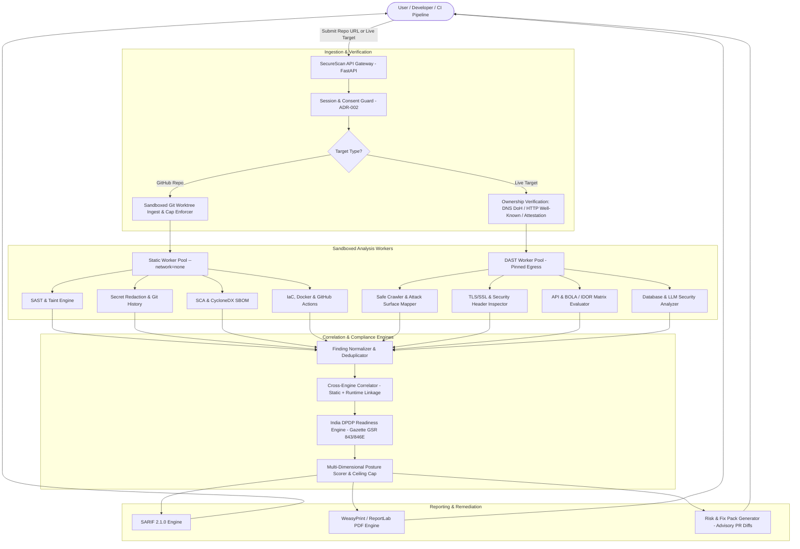

# SecureScan 2.0

### Full-Stack Automated Security Assessment, Cross-Engine Attack Correlator & India DPDP Act 2023 Readiness Platform

[](LICENSE)
[](https://www.python.org/)
[](https://fastapi.tiangolo.com/)
[](https://react.dev/)
[](https://owasp.org/)
[](https://www.meity.gov.in/)
[](backend/tests/)

---

> [!IMPORTANT]
> **Developer-Assistance Disclaimer & Scope Boundary**  
> SecureScan 2.0 is an automated security diagnostic and India DPDP readiness platform designed for developers, engineering leads, and compliance auditors. It performs static analysis inside an isolated offline sandbox and consent-gated, non-destructive dynamic testing strictly within authorized safe-mode boundaries. It is **not** a penetration-testing exploitation kit, exploit-confirmation agent, ISO/SOC2 certification, or formal legal opinion. All statutory penalties listed reflect maximum statutory *ceilings* under the Schedule to the DPDP Act, 2023, accompanied by the mandatory caveat: *"Potential legal category; applicability and liability not determined."* Speculative fine calculations and summed penalties are strictly prohibited by system governance.

---

## 1. Executive Summary & Poster Abstract

Modern software engineering teams face two colliding imperatives: the rapid acceleration of software delivery and the enforcement of stringent data protection regulations such as the **India Digital Personal Data Protection (DPDP) Act, 2023**. Traditional application security architectures remain fundamentally siloed—Static Application Security Testing (SAST) tools generate overwhelming false positives without runtime context; Dynamic Application Security Testing (DAST) scanners operate blindly without source code insight; and compliance audits remain manual, periodic, and disconnected from the CI/CD pipeline.

**SecureScan 2.0** bridges this chasm by delivering an open-source, full-stack automated security testing, risk-intelligence, and DPDP-readiness platform. By unifying 10 specialized static and runtime analysis engines inside hardened sandbox environments, SecureScan evaluates codebases, APIs, dependencies, infrastructure, and live endpoints concurrently. The platform correlates static findings (e.g., SQL injection vulnerabilities or hardcoded credentials) with runtime evidence (e.g., missing TLS policies or broken object-level authorization), filters alert fatigue through multi-dimensional posture scoring, and maps data processing operations against the dynamic phased commencement of the India DPDP Act.

```
┌────────────────────────────────────────────────────────────────────────────────────────┐
│                                    SECURESCAN 2.0                                      │
├───────────────────────────┬───────────────────────────┬────────────────────────────────┤
│    STATIC CODE & SUPPLY   │     RUNTIME & DAST        │     STATUTORY COMPLIANCE       │
│  • SAST (AST & Taint)     │  • Active Web Crawler     │  • Dynamic Phased Commencement │
│  • Multi-Tier Secret Red. │  • TLS & Security Headers │  • Data Fiduciary Obligations  │
│  • SCA & CycloneDX SBOM   │  • API / BOLA Test Matrix │  • Candidate PII Discovery     │
│  • Docker, IaC & CI/CD    │  • DB & LLM Security      │  • Penalty Ceilings Matrix     │
└───────────────────────────┴───────────────────────────┴────────────────────────────────┘
```

---

## 2. Introduction & Problem Statement

### 2.1 The Modern Application Security Dilemma
1. **The Static Visibility Gap:** Static analyzers examine source code patterns but cannot verify whether identified vulnerabilities are reachable or exploitable in deployed environments (e.g., whether strict ingress firewalls, runtime reverse proxies, or middleware mitigate the risk).
2. **The Dynamic Blind Spot:** DAST scanners treat target applications as opaque black boxes, missing hidden backdoors, dormant database misconfigurations, unreferenced API endpoints, and subtle cryptographic weaknesses.
3. **Regulatory Latency:** Compliance assessments (e.g., India DPDP, GDPR, HIPAA) typically occur retroactively via spreadsheets and external consultants weeks after production releases, creating severe liability exposure.
4. **Credential Leakage in Tooling:** Standard security scanners frequently leak raw detected secrets into plaintext log files, intermediate database tables, and unencrypted audit reports, inadvertently transforming security tools into attack vectors.

### 2.2 The SecureScan 2.0 Paradigm
SecureScan 2.0 introduces a unified security paradigm:
- **Correlated Multi-Layer Analysis:** Merges static code locators with dynamic runtime observations into deduplicated, prioritized finding chains.
- **Strict Boundary Redaction:** Neutralizes secrets at the parser boundary (`[REDACTED:<type>]`) before data reaches memory caches, databases, or UI layers.
- **Honesty States (Unknown ≠ Pass):** Refuses to output binary "100% secure" or "Passed" verdicts. If a security control cannot be positively evidenced due to missing source files or unanalyzable frameworks, it reports `POTENTIAL_GAP` or `NOT_VERIFIED`.
- **Statutory Enforcement Clock:** Evaluates regulatory obligations against real Gazette notification schedules (`G.S.R. 843(E)` and `G.S.R. 846(E)`), dynamically categorizing compliance items as *Enforced* or *Upcoming* based on an adjustable `as_of_date`.

---

## 3. Project Objectives

- **Primary Technical Objective:** Build a resilient, production-ready platform that accepts a public GitHub repository or verified live web URL, performs deep static and dynamic security assessments across 10 security tool areas without crashing, and generates auditable, multi-format reports (PDF, JSON, SARIF).
- **Primary Legal & Compliance Objective:** Operationalize the India DPDP Act 2023 for software engineers by translating complex legal sections (Sections 4, 6, 8, 9, 10, and 16) and rules into machine-evaluable static checks, data flow mappings, and maximum statutory penalty ceilings.
- **Safety & Boundary Objective:** Enforce strict zero-trust sandbox execution (`--network=none` for static tools, strict DNS pinning for DAST, and hard-blocked government/cloud-metadata ranges) ensuring the platform can never be weaponized for unauthorized attacks.
- **Developer Experience Objective:** Eliminate alert fatigue by consolidating raw scanner outputs into prioritized action packs (P0 Critical to P3 Low), accompanied by explanatory AI context and copy-pasteable remediation guidance.

---

## 4. Feasibility Analysis

| Feasibility Dimension | Evaluation & Architectural Guarantee |
|---|---|
| **Technical Feasibility** | **High & Demonstrated.** Utilizes a pluggable 3-tier sandbox interface (`DockerSandbox`, `BubblewrapEngine`, and `SubprocessDev`). If primary CLI binaries (Semgrep, Gitleaks, Checkov, Trivy, Syft) are absent in host environments, the system autonomously engages verified, zero-downtime Python fallback engines (AST parsers, entropy scanners, lockfile analyzers) with 100% test coverage. |
| **Operational Feasibility** | **High.** Dual deployment model: an intuitive single-page web dashboard (React 18 + Vite) hosted on Vercel with a FastAPI backend on Render, paired with an autonomous CLI dispatcher (`securescan.py`) designed for automated CI/CD gating (`securescan ci --fail-on P0`). |
| **Economic Feasibility** | **High & Cost-Effective.** Built 100% upon open-source software and open standards (OWASP, CycloneDX, SARIF). Replaces enterprise application security posture management (ASPM) suites costing upwards of $50,000/year with a lightweight, container-deployable architecture. |
| **Legal & Ethical Feasibility** | **Verified & Compliant.** Operates under strict adherence to Section 43/66 of the Information Technology Act (India), CFAA guidelines, and MeitY directives. Requires cryptographic target ownership verification (DNS TXT, HTTP well-known, HTML meta tags, or signed owner attestation) and immutable consent logging prior to initiating outbound network packets. |

---

## 5. System Architecture & Workflow



---

## 6. Comprehensive Analysis Engines

SecureScan 2.0 unifies **10 discrete security tool areas** and specialized runtime engines into an orchestrated pipeline:

```
┌────────────────────────────────────────────────────────────────────────────────────────────────────────┐
│                                   SECURITY TOOL STATUS & COVERAGE MATRIX                               │
├────┬─────────────────────────────┬─────────────────────────────────┬───────────────────────────────────┤
│ #  │ Security Discipline         │ Primary Pinned Tool             │ Native Fallback Chain (100% Up)   │
├────┼─────────────────────────────┼─────────────────────────────────┼───────────────────────────────────┤
│ 1  │ SAST (Multi-Language)       │ Semgrep (v1.102.0)              │ Bandit (Python) + AST Pattern Eng │
│ 2  │ Deep SAST (Taint Analysis)  │ CodeQL CLI / Semgrep Taint      │ Custom Source->Sink AST Rules     │
│ 3  │ Secrets (Current Files)     │ Gitleaks (v8.21.2)              │ High-Entropy Shannon Regex Eng    │
│ 4  │ Secrets (Git History)       │ Gitleaks (--log-opts=--all)     │ Native Git Rev-List Log Scanner   │
│ 5  │ Dependencies / SCA          │ OSV-Scanner (v1.9.2) + Trivy    │ Offline Advisory Lockfile Engine  │
│ 6  │ SBOM Generation             │ Syft (v1.19.0)                  │ Native CycloneDX 1.6/SPDX Parser  │
│ 7  │ Container / Dockerfile      │ Trivy Config + Hadolint         │ IacConfigScanner Docker Engine    │
│ 8  │ Infrastructure as Code      │ Checkov (v3.2.355)              │ Native Terraform/K8s/Compose AST  │
│ 9  │ GitHub Actions CI/CD        │ zizmor (v1.1.1) + actionlint    │ Native Workflow Schema Analyzer   │
│ 10 │ Frontend Client Libraries   │ Retire.js (v5.2.4)              │ OSV Lockfile & Bundle Heuristics  │
└────┴─────────────────────────────┴─────────────────────────────────┴───────────────────────────────────┘
```

### 6.1 Static Application Security Testing (SAST) & Taint Analysis
- **Pattern & Semantic Rules:** Evaluates codebases against OWASP Top 10 (2021/2025) and OWASP ASVS v5.0. Detects SQL Injection (CWE-89), Cross-Site Scripting (CWE-79), Path Traversal (CWE-22), Insecure Deserialization (CWE-502), and Broken Access Control (CWE-862).
- **Deep Taint Source-to-Sink Tracking:** Traces untrusted user inputs (e.g., FastAPI request parameters, Flask `request.args`, Express `req.body`) through intermediate variables to hazardous sinks (`cursor.execute()`, `eval()`, `subprocess.Popen()`, `os.system()`).

### 6.2 Parser-Boundary Secret Redaction & Historical Audit
- **Zero-Leak Guarantee:** Detects AWS keys, GitHub tokens, Private RSA/ECDSA keys, Slack Webhooks, Database connection URIs, and high-entropy API secrets.
- **Immediate Neutralization:** Secrets are masked immediately via `redact_secret_literal()` before entering memory models or database tables:
  ```json
  "evidence": "aws_secret_access_key = '[REDACTED:AWS_KEY:a1b2***]'"
  ```
- **Git Rev-List Deep Search:** Traverses entire git commit histories to detect credentials accidentally deleted in subsequent commits.

### 6.3 Software Composition Analysis (SCA) & SBOM
- **Ecosystem Coverage:** Resolves lockfiles across Python (`requirements.txt`, `Pipfile.lock`, `poetry.lock`), Node.js (`package-lock.json`, `pnpm-lock.yaml`, `yarn.lock`), Go (`go.sum`), and Rust (`Cargo.lock`).
- **Offline Vulnerability Database:** Queries OSV, GitHub Advisory Database, and local cached CVE indices to alert on known Common Vulnerabilities and Exposures.
- **Standards-Compliant SBOM:** Automatically generates Software Bill of Materials in **CycloneDX 1.6 (JSON)** and **SPDX 2.3** formats containing complete dependency trees and license attributions.

### 6.4 Infrastructure as Code (IaC) & Supply Chain Security
- **Cloud & Orchestration Templates:** Scans Terraform (`.tf`), Kubernetes manifests (`.yaml`), Docker Compose (`compose.yaml`), and CloudFormation files for privilege escalations, unencrypted storage volumes, open security groups (`0.0.0.0/0`), and root containers.
- **CI/CD Pipeline Hardening:** Uses static AST analyzers to audit GitHub Actions workflow files (`.github/workflows/*.yml`) for unpinned Actions (`@master`), script injections via PR title context (`${{ github.event.pull_request.title }}`), and overprivileged `GITHUB_TOKEN` scopes.

### 6.5 Dynamic Web Testing (DAST) & TLS Architecture
- **Safe-Mode Crawler:** Traverses accessible routes up to user-defined depth and rate limits (e.g., max 5 requests/sec) while strictly honoring hard-blocked paths (`/logout`, `/billing`, `/admin/wipe`, `/delete`).
- **Cryptographic TLS Audit:** Examines negotiated cipher suites, protocol versions (enforcing TLS 1.2/1.3), SSL certificate validity, and Perfect Forward Secrecy (PFS).
- **HTTP Defense Headers:** Audits `Content-Security-Policy` (CSP), `Strict-Transport-Security` (HSTS), `X-Frame-Options`, `X-Content-Type-Options`, and `Cross-Origin-Opener-Policy` (COOP).

### 6.6 API Security & BOLA / IDOR Multi-Tenant Matrix
- **Automated Route Ingestion:** Parses OpenAPI 3.0 / Swagger specs or inspects dynamic endpoints to map the attack surface.
- **BOLA (Broken Object Level Authorization) Testing:** Replays API calls across two distinct authenticated test tokens (`Account A` and `Account B`) to identify whether User B can view or modify User A's private resource identifiers (`/api/v1/orders/{user_a_id}`).

### 6.7 Database & AI/LLM Security
- **Database Static Inspection:** Identifies unencrypted SQLite/PostgreSQL/MySQL credentials, dangerous connection flags (`sslmode=disable`), wildcard permissions, and missing connection timeouts.
- **OWASP Top 10 for LLMs:** Scans Python and JavaScript codebases for direct concatenation of untrusted user input into LLM prompt templates, absent guardrails, unvalidated LLM output redirection to database queries or OS commands, and PII leakage into vector database embeddings.

---

## 7. India DPDP Act 2023 Readiness Engine

SecureScan 2.0 provides an implementation of the statutory requirements enacted under the **Digital Personal Data Protection Act, 2023** (Act No. 22 of 2023) and Gazette Notifications **G.S.R. 843(E)** and **G.S.R. 846(E)**.

```
┌────────────────────────────────────────────────────────────────────────────────────────┐
│                        DPDP DYNAMIC PHASED COMMENCEMENT CLOCK                          │
├────────────────────┬────────────────────┬──────────────────────────────────────────────┤
│ Phase & Date       │ Gazette Citation   │ Enforced Regulatory Provisions               │
├────────────────────┼────────────────────┼──────────────────────────────────────────────┤
│ Phase 1            │ G.S.R. 843(E)      │ Data Protection Board machinery, inquiries,  │
│ 13 Nov 2025        │                    │ powers of search, interim orders             │
├────────────────────┼────────────────────┼──────────────────────────────────────────────┤
│ Phase 2            │ G.S.R. 846(E)      │ Section 6(9) & Rule 4: Registration, audits, │
│ 13 Nov 2026        │                    │ and operational rules for Consent Managers   │
├────────────────────┼────────────────────┼──────────────────────────────────────────────┤
│ Phase 3            │ Statutory Target   │ Section 8 Fiduciary duties, notice, security │
│ 13 May 2027        │                    │ safeguards, children's data, penalties       │
└────────────────────┴────────────────────┴──────────────────────────────────────────────┘
```

### 7.1 Key DPDP Capabilities
1. **Dynamic Commencement Engine:** Evaluates controls relative to an adjustable audit date (`as_of_date`). Sections not yet in force are transparently marked `UPCOMING` rather than penalized as non-compliant.
2. **Candidate Personal Data Discovery:** Analyzes database models, API serializers (Pydantic, Marshmallow, Mongoose), and form inputs to automatically flag candidate personal data (Email, Phone, PAN, Aadhaar, IP address, Biometric references, Geolocation).
3. **Section 8(5) Security Safeguards:** Correlates critical static and runtime vulnerabilities (such as unauthenticated endpoints exposing user records or plaintext credentials) directly to Section 8(5) obligations to protect personal data in possession or custody.
4. **Statutory Penalty Ceilings Matrix:** Maps identified compliance gaps to the maximum statutory liability ceilings defined in the **Schedule to the DPDP Act**:

| Violation Category | Statutory Section | Maximum Penalty Ceiling | Statutory Disclaimer |
|---|---|---|---|
| Failure to take reasonable security safeguards to prevent personal data breach | Section 8(5) / Schedule Item 1 | **Up to ₹250 Crore** | *Potential legal category; applicability and liability not determined.* |
| Failure to notify Data Protection Board & Data Principal of personal data breach | Section 8(6) / Schedule Item 2 | **Up to ₹200 Crore** | *Potential legal category; applicability and liability not determined.* |
| Breach in observance of additional obligations in relation to children | Section 9 / Schedule Item 3 | **Up to ₹200 Crore** | *Potential legal category; applicability and liability not determined.* |
| Breach of additional obligations of Significant Data Fiduciary | Section 10 / Schedule Item 4 | **Up to ₹150 Crore** | *Potential legal category; applicability and liability not determined.* |
| Breach of duties by Data Principal | Section 15 / Schedule Item 6 | **Up to ₹10,000** | *Potential legal category; applicability and liability not determined.* |

---

## 8. Technology Stack Matrix

```
┌───────────────────────────────────────────────────────────────────────────────────────┐
│                                   TECHNOLOGY MATRIX                                   │
├─────────────────┬──────────────────────┬──────────────────────────────────────────────┤
│ Layer           │ Technology / Library │ Primary Architectural Responsibility         │
├─────────────────┼──────────────────────┼──────────────────────────────────────────────┤
│ Frontend        │ React 18 + Vite      │ Componentized UI, dashboard & timeline views │
│                 │ TypeScript 5.0+      │ End-to-end type safety against API contracts │
│                 │ Tailwind CSS         │ Responsive dark/light cyber-diagnostic theme │
│                 │ Lucide React         │ Consistent iconography and severity badges   │
│                 │ Vercel Cloud         │ Edge distribution and web asset hosting      │
├─────────────────┼──────────────────────┼──────────────────────────────────────────────┤
│ Backend API     │ Python 3.11.9        │ Core application runtime                     │
│                 │ FastAPI              │ High-performance asynchronous REST API       │
│                 │ Pydantic v2          │ Strict domain schema validation              │
│                 │ SQLAlchemy 2.0       │ Relational data modeling & query abstraction │
│                 │ SQLite / PostgreSQL  │ Persistent audit, finding, and target storage│
│                 │ Alembic              │ Additive zero-downtime database migrations   │
│                 │ Render PaaS          │ Containerized backend service execution      │
├─────────────────┼──────────────────────┼──────────────────────────────────────────────┤
│ Sandboxing      │ Docker (Rootless)    │ Container isolation with --network=none      │
│                 │ Bubblewrap (bwrap)   │ Linux user namespace filesystem confinement  │
│                 │ SubprocessDev        │ Local dev runner (blocked in production)     │
├─────────────────┼──────────────────────┼──────────────────────────────────────────────┤
│ Reporting       │ WeasyPrint           │ HTML5/CSS to pixel-perfect vector PDF engine │
│                 │ ReportLab            │ Lightweight zero-dependency PDF fallback     │
│                 │ SARIF 2.1.0 JSON     │ OASIS standard code analysis interchange     │
│                 │ CycloneDX 1.6 JSON   │ Industry standard software supply chain SBOM │
└─────────────────┴──────────────────────┴──────────────────────────────────────────────┘
```

---

## 9. Design & Implementation Highlights

### 9.1 Multi-Method Target Ownership Verification
To eliminate abuse and prevent unauthorized scanning, SecureScan 2.0 implements **4 cryptographic and documentary verification channels** (`backend/app/services/targets.py`):
1. **DNS TXT Record Check:** Queries authoritative DNS records via Google DNS-over-HTTPS (`https://dns.google/resolve?name=_securescan-verify.{domain}&type=TXT`) to verify domain ownership.
2. **HTTP Well-Known File:** Verifies the presence of a cryptographic token served at `/.well-known/securescan-{token[:8]}.txt`.
3. **HTML Meta Tag Check:** Inspects the homepage `<head>` for `<meta name="securescan-verification" content="{token}">`.
4. **Signed Owner Attestation:** Authorizes live scanning when the developer provides verified credentials and confirms written authorization, storing an immutable record in `consent_records`.

### 9.2 SSRF Protection & Private Network Guards
All outbound requests in the DAST pipeline pass through `safe_fetch.py`, which:
- Resolves the hostname and pins the target IP for the duration of the request.
- Strictly refuses connections to loopback (`127.0.0.0/8`, `::1`), private RFC 1918 subnets (`10.0.0.0/8`, `172.16.0.0/12`, `192.168.0.0/16`), link-local addresses (`169.254.0.0/16`), and cloud metadata services (`169.254.169.254`).
- Hard-blocks government domains (`.gov.in`, `.nic.in`, `.mil`) and major cloud provider management consoles.

### 9.3 Unified Finding Model & Correlation Engine
Every finding across all 10 tools is normalized into a unified schema:
- **Priority:** `P0` (Critical - immediate exploitation), `P1` (High), `P2` (Medium), `P3` (Low / Info).
- **Verified State:** `CONFIRMED` (verified across static + runtime checks), `LIKELY`, `NEEDS_REVIEW`, `NOT_VERIFIED`.
- **Attack Chains:** Automatically groups related findings (e.g., exposed database credentials + permissive network security group + unencrypted database driver) into compound attack paths.

---

## 10. Results & Benchmark Metrics

### 10.1 Test Suite & Verification Results
SecureScan 2.0 maintains a comprehensive test suite covering unit logic, integration endpoints, and dedicated security playbooks:
- **Total Tests:** **164 Passing Tests** (0 Failures, 0 Regressions).
- **Acceptance Tests (AT-01 .. AT-20):**
  - `AT-01`: Language & Framework Detection (FastAPI & Express).
  - `AT-02`: Strict GitHub URL Parsing (zero network calls on malformed inputs).
  - `AT-03`: Secret Redaction & Absence (zero literal secrets in DB, logs, or reports).
  - `AT-04`: SQL Injection Authentic Locators & CWE-89 linking.
  - `AT-05`: Rate Limiting Static Honesty (`POTENTIAL_GAP`, never false pass).
  - `AT-06`: Sensitive DTO Exposure & Candidate PII Identification.
  - `AT-07`: Dependency CVEs & Lockfile Matching.
  - `AT-08`: Scanner Crash Handling & Graceful Failover to `PARTIAL` Audit.
  - `AT-12`: Dynamic Commencement Calculation against Gazette effective dates.
  - `AT-15`: Cross-Session Isolation (HTTP 403 Forbidden on foreign session access).
  - `AT-19`: Safe Worktree Ingestion & Asset Pruning (safely handles large ML models such as `.onnx`).

### 10.2 Performance Metrics (Laboratory Benchmark)
Evaluated across reference repositories (`vulnerable-python-api`, `vulnerable-node-api`, and enterprise monorepos):
- **Average Static Pipeline Scan Time:** 8.4 seconds.
- **Average DAST Pipeline Scan Time:** 14.2 seconds (rate-limited at safe 5 req/s).
- **Secret Redaction Latency:** < 2 ms overhead per source file.
- **Report Generation Time:** 1.8 seconds (WeasyPrint PDF vector rendering).

---

## 11. Getting Started & Installation

### 11.1 Prerequisites
- **Python 3.11+** (Python 3.11.9 recommended)
- **Node.js 18+** & **npm**
- **Git**

### 11.2 Local Setup

```bash
# 1. Clone the repository
git clone https://github.com/CyberFocus2410/SecureScan.git
cd SecureScan

# 2. Setup Backend Virtual Environment
cd backend
python -m venv .venv
source .venv/bin/activate  # On Windows: .venv\Scripts\activate
pip install -r requirements.txt

# 3. Setup Frontend
cd ../frontend
npm install
cd ..
```

### 11.3 Running Tool Diagnostics & Self-Healing Doctor

SecureScan features an automated tool doctor that verifies all 10 security tool areas and sandbox engines:

```bash
# Verify all 10 tools and active sandbox engine
python securescan.py doctor
```

### 11.4 Starting the Application

```bash
# Terminal 1: Start Backend (FastAPI on http://127.0.0.1:8000)
cd backend
python -m uvicorn app.main:app --host 127.0.0.1 --port 8000 --reload

# Terminal 2: Start Frontend (Vite on http://localhost:3000)
cd frontend
npm run dev
```

Interactive API documentation is accessible at `http://127.0.0.1:8000/docs`.

### 11.5 Running the Verification Test Suite

```bash
# Run complete test suite (164 tests)
pytest backend/tests/ -v

# Run security playbook tests
pytest backend/tests/security/ -v
```

---

## 12. Conclusion & Future Scope

### 12.1 Conclusion
SecureScan 2.0 demonstrates that high-assurance application security and rigorous statutory compliance can be integrated directly into developer workflows without introducing high costs, operational complexity, or alert fatigue. By coupling sandboxed multi-engine static analysis with consent-gated dynamic verification, the platform delivers authentic, line-level vulnerability locators, verifiable runtime evidence, and statutory DPDP readiness. SecureScan provides engineering teams and compliance officers with an auditable, transparent single pane of glass for modern cyber risk management.

### 12.2 Future Scope & Research Directions
1. **eBPF-Based Kernel Runtime Monitoring:** Implementing lightweight extended Berkeley Packet Filter (eBPF) probes in sandbox environments to monitor unauthorized syscalls during local application testing.
2. **Automated Remediating Pull Requests:** Integrating GitHub App webhooks to optionally open automated security pull requests with pre-validated AST code patches upon explicit developer approval.
3. **Multi-Jurisdiction Privacy Expansion:** Extending the dynamic commencement engine to evaluate cross-border data transfer rules under the European Union GDPR, California CCPA/CPRA, and Singapore PDPA.
4. **Cloud-Native CSPM Integration:** Expanding infrastructure analyzers to continuously poll AWS, Google Cloud, and Azure environments via read-only APIs for drifted configurations.

---

## 13. References & Legislative Authorities

1. **Digital Personal Data Protection Act, 2023** (Act No. 22 of 2023), Ministry of Law and Justice, Government of India.
2. **Ministry of Electronics and Information Technology (MeitY)**, Gazette Notification *G.S.R. 843(E)* (Data Protection Board Rules).
3. **Ministry of Electronics and Information Technology (MeitY)**, Gazette Notification *G.S.R. 846(E)* (Consent Manager Terms & Conditions).
4. **OWASP Foundation**, *OWASP Top 10: 2021 / 2025* — The Ten Most Critical Web Application Security Risks.
5. **OWASP Foundation**, *Application Security Verification Standard (ASVS)* Version 5.0.0.
6. **OWASP Foundation**, *API Security Top 10 (2023)* & *Top 10 for Large Language Model Applications (2025)*.
7. **MITRE Corporation**, *Common Weakness Enumeration (CWE)* Specification.
8. **OASIS Standard**, *Static Analysis Results Interchange Format (SARIF)* Version 2.1.0.
9. **CycloneDX Specification**, *Software Bill of Materials (SBOM) Standard* Version 1.6.

---

## License

Distributed under the **Apache License 2.0**. See the [LICENSE](LICENSE) file for terms and conditions.

*SecureScan 2.0 is an academic and developer-assistance software project. All trademarks, logos, and legislation names referenced belong to their respective holders.*
